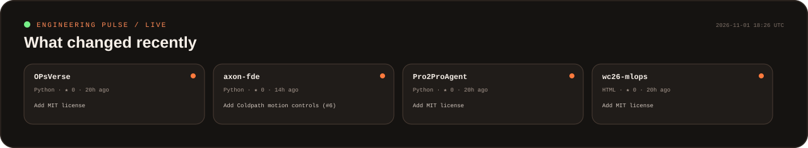

<div align="center">



<br/>

### Dilip Nallamasa
**LLM inference · Serving reliability · ML systems**

I find the numbers LLM serving systems get quietly wrong (routing on stale latency, metrics that hide a stall, benchmarks that disagree about what "latency" means), prove it with a test or a measurement, and fix it upstream.

**2 merged PRs in the vLLM project's [AIBrix](https://github.com/vllm-project/aibrix) gateway** · open work in vLLM, Ray, GuideLLM · [case studies](https://github.com/dilipna/llm-serving-case-studies)

[Portfolio](https://dilip-portfolio-one.vercel.app/) · [LinkedIn](https://www.linkedin.com/in/dilip-n-ab1091417/) · [Email](mailto:dilip.nallamasa@gmail.com)

</div>

---

### `open source / measured`

| Project | What was wrong | Status |
|---|---|---|
| **[AIBrix](https://github.com/vllm-project/aibrix)** routing | Least-latency scored pods by a lifetime average, so a pod that had slowed down kept winning traffic for about 10 minutes after 100,000 requests. A one-minute window, with fallbacks for quiet pods and engine restarts, cuts that to 15 seconds; the change covers all three schedulers that used the lifetime mean. The maintainer reproduced the analysis before merging. [Case study →](https://github.com/dilipna/llm-serving-case-studies/tree/main/aibrix-routing) | **merged** · [#3327](https://github.com/vllm-project/aibrix/pull/3327) (from my issue [#3297](https://github.com/vllm-project/aibrix/issues/3297)) |
| **AIBrix** metrics | An empty histogram was exported as a real p50/p90/p99, so dashboards showed latencies that never happened. | **merged** · [#3290](https://github.com/vllm-project/aibrix/pull/3290) |
| **[vLLM](https://github.com/vllm-project/vllm)** scheduler | With speculative decoding, a request that could not fit its draft tokens preempted another request. Dropping the drafts first cut preemptions from 72.5 to 54.0 in a small local benchmark, with token-identical outputs. | open · [#63079](https://github.com/vllm-project/vllm/pull/63079) |
| **vLLM** streaming | Reproduced a streaming bug and validated another author's fix on a GPU: 18 of 640 requests broken before, 0 of 640 after. The author cited the numbers to request review. | [validation on #62726](https://github.com/vllm-project/vllm/pull/62726#issuecomment-6304402477) |
| **AIBrix** batch | One `NaN` latency in a response leaves the adaptive concurrency controller at full load while the engine slows 50x. | issue [#3339](https://github.com/vllm-project/aibrix/issues/3339) accepted · fix [#3350](https://github.com/vllm-project/aibrix/pull/3350) open |
| **[Ray](https://github.com/ray-project/ray)** Data LLM | The documented "-1 means unlimited" setting crashed the vLLM engine stage, and error rows lost their prompt; mocked tests hid both. | open · [#67460](https://github.com/ray-project/ray/pull/67460) |
| **[GuideLLM](https://github.com/vllm-project/guidellm)** | Non-streaming requests were counted as 0 ms inter-token latency samples. | open · [#1406](https://github.com/vllm-project/guidellm/pull/1406) |
| **[CodeCarbon](https://github.com/mlco2/codecarbon)** | Country carbon intensities were 2 to 4 years old. A script now rebuilds them from the maintained dataset. | open · [#1468](https://github.com/mlco2/codecarbon/pull/1468) |

**[llm-bench-wire-audit](https://github.com/dilipna/llm-bench-wire-audit)**: a logging proxy that checks what `vllm bench serve`, GuideLLM and AIPerf report against what actually crossed the wire. Where definitions match they agree with the wire within a few percent. Under an injected 300 ms stall, one tool's p99 inter-token latency reads 311 ms and another's reads 16.6 ms, because one averages per request and one does not.

<sub>Statuses checked 2026-10-31.</sub>

### `proof > adjectives`

| System | Engineering problem | Evidence |
|---|---|---|
| **[Furnace](https://github.com/dilipna/Furnace4LLM)** · [demo](https://furnace-5h6.pages.dev/prefix-check) | Pull-request gate for LLM apps on their own vLLM server: replays both revisions' real prompts, gates on time to first token, catches prompt edits that break prefix caching | **234 → 43 ms** p50 TTFT · **94%** cache reuse restored · **720** requests re-checkable from raw records |
| **[OpsVerse](https://github.com/dilipna/OPsVerse)** · [demo](https://ops-verse.vercel.app/) | Post-train Qwen3-4B, retrieve with BGE + BM25 + RRF, rerank, ground citations, gate releases with evals, serve with vLLM | **MRR@10 0.705** · **1,914** graded judgments · **245** regression tests · **~6×** lower cost/response |
| **[AxonFDE](https://github.com/dilipna/axon-fde)** · [demo](https://dilipna.github.io/axon-fde/#top) | Fuse telemetry, orders, and shipping docs; predict breaches; reconcile conflicts; require human approval; audit every action | **49 min** median lead time · **23/23** planted conflicts · **0** unauthorized actions / 50 tests · **4.92 s** decision cycle |
| **[Pro2Pro](https://github.com/dilipna/Pro2ProAgent)** · [demo](https://protopro.vercel.app/) | Checkpointed LangGraph + MCP orchestration with resumable state, human approval, guardrails, tracing, and model fallback | **78** evaluation tests |
| **[FIFA2026MLOps](https://github.com/dilipna/wc26-mlops)** · [demo](https://fifa2026mlops.vercel.app/) | Elo + gradient boosting + Monte Carlo forecasting with automated training, validation, deployment, lineage, and drift monitoring | **Airflow · MLflow · Evidently · OpenTelemetry** |



### `research / active`

<table>
<tr>
<td width="50%" valign="top">

#### ♟ ChessAssistLens
Research with **Prof. Kenneth W. Regan**

Compare a **Regan-inspired statistical reconstruction**, **Qwen3-8B**, and **Maia-3** on the same chess decisions using Stockfish MultiPV and controlled engine-assisted substitutions.

**Measured result**

`+0.047 AUC` Maia-derived signal gain  
`95% CI +0.040 → +0.054`  
`2,000` paired source-game bootstrap resamples

[Open research demo →](https://chessassistlens.vercel.app/)

</td>
<td width="50%" valign="top">

#### 🛡 Physical AI Security
Research with **Prof. Haipeng Cai**

Systematizing failure modes of LLM/VLM-driven physical agents across prompt/tool attacks, adversarial perception, leakage, and unsafe actions.

**Current direction**

LLM-assisted vulnerability localization → patch proposal → sandbox regression test.

</td>
</tr>
</table>

### `engineering surface`

```text
LANGUAGES     Python · Go · SQL
SERVING       vLLM · AIBrix · Ray Data LLM · FastAPI · asyncio / aiohttp · Docker · Kubernetes · AWS
MEASUREMENT   TTFT / ITL / TPOT definitions · benchmark design · fault injection · Prometheus histograms
MODELS        PyTorch · Transformers · Qwen · TRL · PEFT · QLoRA · SFT · DPO
RETRIEVAL     RAG · BGE · BM25 · RRF · reranking · Qdrant
AGENTS        LangGraph · LangChain · MCP · tool use · human-in-the-loop
EVALUATION    benchmarks · regression tests · paired bootstrap · guardrails · red teaming
OBSERVABILITY Langfuse · OpenTelemetry · MLflow · Evidently · CI/CD
```

### `published`

- **[GWO-Based Fed-UNet-CNN Model for Leukocytes Classification Across Developmental Stages](https://doi.org/10.21203/rs.3.rs-9183195/v1)**
- **[The Future of Smart Factories: Real-Time Automation and Big Data Analytics](https://ieeexplore.ieee.org/document/10726023)**

---

## Building, one commit at a time.

<p align="center">
  <picture>
    <source
      media="(prefers-color-scheme: dark)"
      srcset="https://raw.githubusercontent.com/dilipna/dilipna/output/github-contribution-grid-snake-dark.svg"
    />
    <source
      media="(prefers-color-scheme: light)"
      srcset="https://raw.githubusercontent.com/dilipna/dilipna/output/github-contribution-grid-snake.svg"
    />
    
  </picture>
</p>

<div align="center">

### Building AI that has to work after the demo.

**AI Engineering Intern @ Globant** · **M.S. AI @ University at Buffalo · Dec 2026**

<sub>The activity panel above is generated from GitHub data by a scheduled GitHub Action in this profile repository.</sub>

</div>
